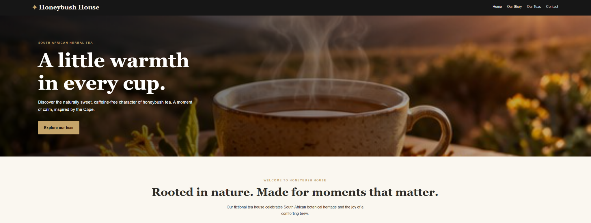

# Honeybush House — AWS cloud engineering case study

A four-page website for a fictional South African tea brand, deployed manually with **Amazon S3, CloudFront and Origin Access Control (OAC)**.

**Outcome:** The guided deployment was reported successful in October 2026 after resolving an `AccessDenied` error caused by incorrect S3 object paths. **The CloudFront demo is offline; the distribution was disabled after testing.**

Historical deployment address: `https://d2f36m657zlp75.cloudfront.net/` — retained as a reference, not a live demo link. See the [offline-status commit](https://github.com/Maxhego/Project-01-Honeybush-House-/commit/8c7af193b347e74964fb585abcc7b3482a2c8af0).

## Website preview

User-supplied desktop capture, received 30 October 2026; hosting environment unverified. [View all four pages and capture notes](docs/screenshots/README.md). The CloudFront demo remains offline.

## At a glance

| Item | Detail |
|---|---|
| Goal | Serve a static website over HTTPS while keeping the S3 origin private |
| Scope | Home, Our Story, Our Teas and Contact; HTML, CSS, JavaScript and image assets |
| Deployment | AWS Console; S3 in `eu-north-1`; CloudFront for delivery |
| Learning focus | Object paths, private origin access, CDN configuration, cache invalidation and troubleshooting |
| Contribution | Guided AWS configuration, upload and browser testing; website code prepared with AI assistance |
| Evidence level | Deployment results are user-reported; desktop captures are committed; hosting environment and HTTP checks remain unverified |
| Current limits | Contact form is demo-only; no checkout or backend |

This is the first project in a five-project beginner AWS cloud engineering portfolio. Its value is the deployment process and troubleshooting decisions, supported by source code and documentation.

## Architecture and decisions

| Component | Responsibility and reason |
|---|---|
| Private Amazon S3 bucket | Stores site objects without exposing the bucket directly to public readers |
| Amazon CloudFront | Provides the public HTTPS entry point and caches static content at edge locations |
| Origin Access Control | Signs origin requests from CloudFront to S3 |
| S3 bucket policy | Permits reads by the CloudFront service principal for the intended distribution |
| AWS IAM | Controls administrative access; IAM is not a step in the visitor request path |

A browser requests a page through CloudFront. On a cache miss, CloudFront retrieves the object from the regular S3 REST origin using OAC. S3 Block Public Access remains enabled. The default root object is `index.html`; other pages use explicit `.html` paths.

See the [architecture diagram and component details](docs/architecture.md). These describe the documented design, not independently verified current AWS settings.

## Implementation and deployment outcome

1. Prepared the four-page static website and its assets.
2. Created the S3 bucket and uploaded the site through the AWS Console.
3. Configured CloudFront with the private S3 origin, OAC and `index.html` as the default root object.
4. Corrected the uploaded object paths and requested a CloudFront cache invalidation.
5. Tested the four pages through the CloudFront domain; successful loading was reported during the guided deployment.
6. Disabled the CloudFront distribution after the demonstration.

Disabling CloudFront does not establish that all AWS resources were deleted or that billing stopped. S3 storage and previously accrued charges may remain. No cost total or budget alert is verified in this repository.

## Troubleshooting: AccessDenied after upload

**Symptom:** CloudFront returned `AccessDenied` instead of the homepage.

**Finding:** The site files were nested under `Honeybush-House-Project01-FRESH/`, while the distribution expected `index.html` at the bucket root.

**Change:** Uploaded the website contents at the correct root paths and invalidated the CloudFront cache.

**Reported result:** The homepage and the other three pages loaded successfully.

**Lesson:** Check object keys and origin configuration before changing access controls. A 403 alone does not prove a permission problem. Keeping the bucket private was part of the design.

## Validation and evidence

The [test record](docs/testing.md) separates reported historical outcomes from checks that still need evidence. The offline endpoint cannot demonstrate current website operation.

The highest-priority additions are:

1. The 20 website image files are included in [`images/`](images/), and all HTML/CSS image paths resolve. The [asset-provenance record](docs/asset-provenance.md) inventories supplied files, AI-assisted work and project content; image sources and usage rights remain unverified.
2. Desktop captures are now available in the [screenshot gallery](docs/screenshots/README.md). Add a mobile capture with viewport details; preserve clear environment labels.
3. Add dated deployment evidence: S3 root objects, CloudFront origin/OAC and root object, and a completed invalidation.
4. Add recorded HTTPS/HTTP and private-S3 checks, with dates and expected versus actual results, if historical records exist or an authorized future deployment is tested.

See the [prioritized evidence checklist](docs/portfolio-evidence.md) for filenames, captions and missing links. The supplied desktop screenshots show page appearance; they do not verify AWS configuration. No performance scores or successful automation runs are claimed here.

## Inspect the source locally

Clone this repository, open its directory in VS Code, and open `index.html` in a browser (or use a local static server).

The website source includes its 20 image assets in `images/`. Keep this folder alongside the HTML, CSS and JavaScript when previewing locally. The contact form only displays a demo message and does not send messages. Local inspection does not verify AWS configuration.

## Supporting material and automation status

| Material | Status |
|---|---|
| [Architecture](docs/architecture.md) | Documented manually deployed design |
| [Testing](docs/testing.md) | Reported outcomes and pending verification |
| [Security and cost](docs/security-and-cost.md) | Controls to verify and cost considerations |
| [Asset provenance](docs/asset-provenance.md) | 20-file inventory; image origins and usage rights unresolved |
| [Portfolio evidence](docs/portfolio-evidence.md) | Prioritized gaps and capture guidance |
| [CloudFormation example](infra/README.md) | Not deployed or account-validated; creates a separate new stack |
| [GitHub Actions guide](docs/deployment-automation.md) | Manual-dispatch example, not configured or tested; no runs found at review |

The existing deployment was completed through the AWS Console. The template and workflow demonstrate preparation for future reproducibility, not a completed infrastructure-as-code deployment or proven CI/CD pipeline.

## What this project taught me

- How S3 object keys affect website delivery through CloudFront.
- How a public CDN can serve content from a private origin.
- How cached responses affect deployment troubleshooting.
- How to distinguish a successful manual demonstration from reproducible, recorded validation.

Next priorities are deployment evidence and verification of asset sources and usage rights, followed by testing the prepared automation in a separately reviewed deployment. Custom domains, monitoring and a serverless contact form are future extensions.
