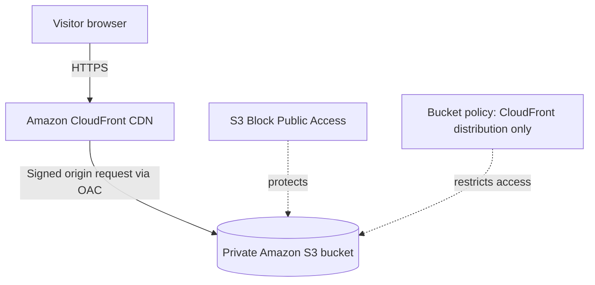

# Honeybush House — AWS architecture

This diagram describes the **manually deployed** website. It is documentation, not a screenshot or proof of current AWS configuration.

## Components
- **Amazon S3** stores the HTML, CSS, JavaScript and image assets. The bucket uses the regular S3 REST endpoint, not the S3 website endpoint.
- **CloudFront** serves the website over HTTPS and caches static files at edge locations.
- **Origin Access Control (OAC)** signs CloudFront requests to S3.
- **S3 bucket policy** grants `s3:GetObject` only to the CloudFront service principal when the source is the intended distribution ARN.
- **Default root object** is `index.html`.

## Historical deployment — currently offline
- S3 region: `eu-north-1`
- S3 bucket: `honeybush-house-project01-001`
- Historical CloudFront address: `https://d2f36m657zlp75.cloudfront.net/` — offline; distribution disabled after testing.
- The deployed resources were configured manually in the AWS Console. The template in `infra/` is **an example for future reproducibility**, not a record of how the manually deployed resources were created.

## Important
Do not turn off S3 Block Public Access to troubleshoot CloudFront. Check the origin type, OAC, bucket policy, object paths and cache invalidation first.
